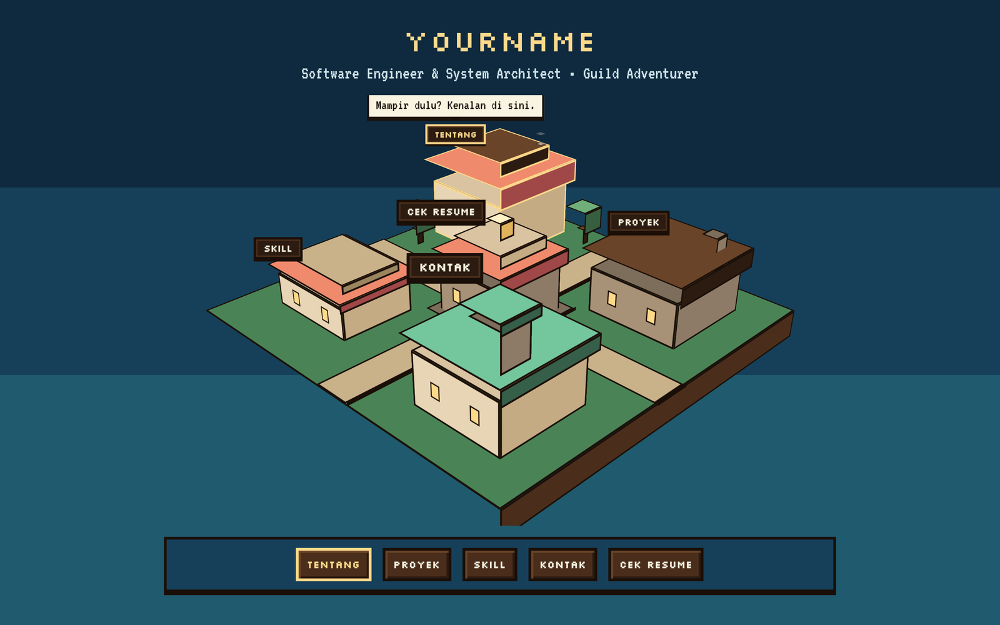
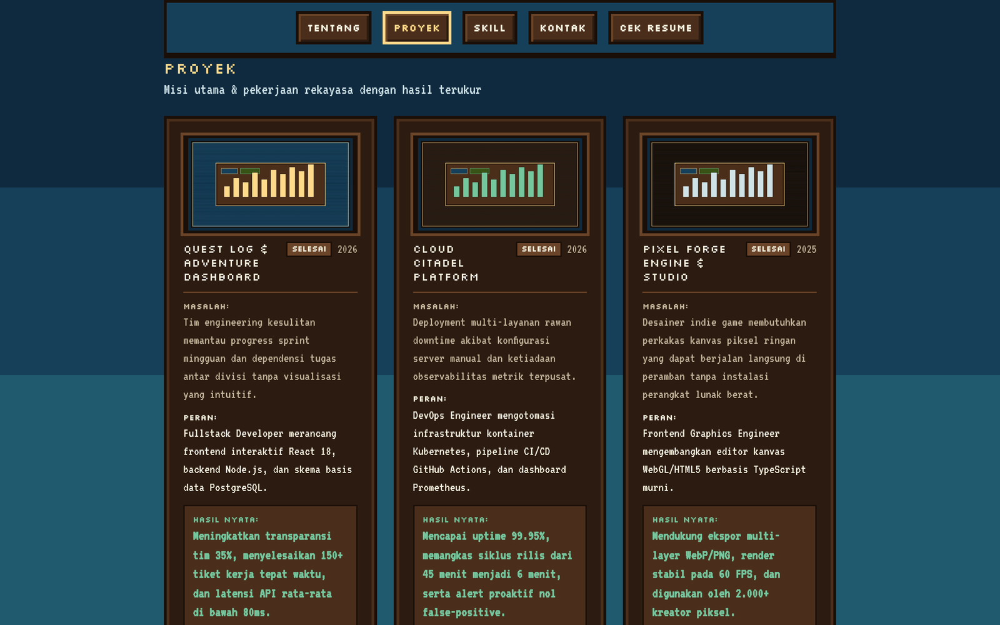
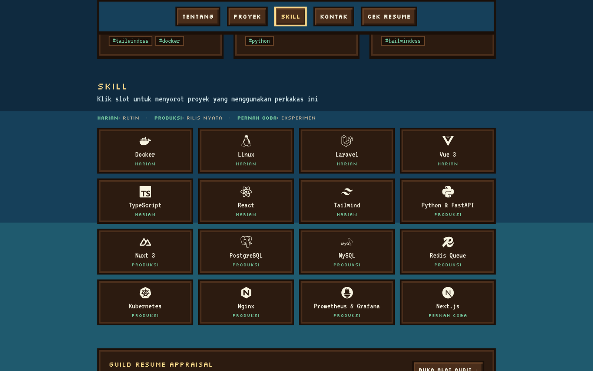
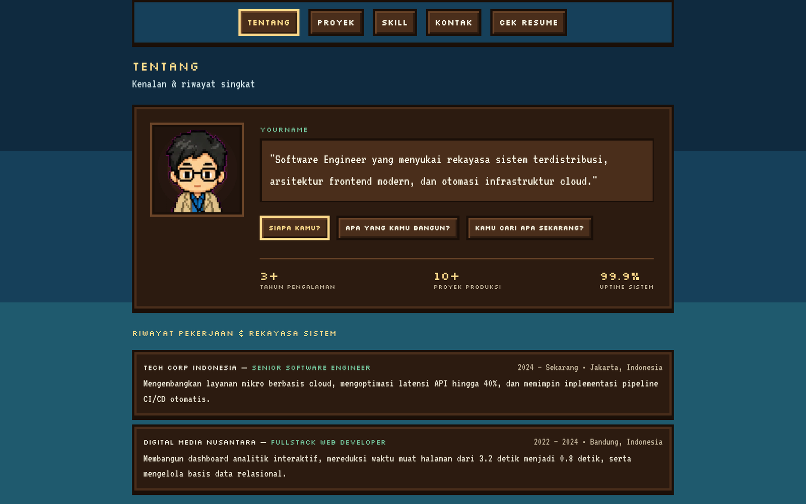

# 16-Bit RPG Developer Portfolio Template

> **Demo**: [profile.uyasky.web.id](https://profile.uyasky.web.id) • **Created by**: [Suryaalghifari](https://github.com/Suryaalghifari) • **License**: MIT

A static, proof-based developer portfolio with a 16-bit isometric RPG aesthetic. Built with **Vite + React 18 + TypeScript + Tailwind CSS**.

Designed to present engineering accomplishments through a structured **Problem - Role - Result** case study format instead of unverified lists. 100% client-side, zero backend database, zero heavy WebGL dependencies, and pre-configured for free Cloudflare Pages edge hosting.



---

## Key Features

### Pure CSS 3D Isometric Island
Interactive 3D voxel stage rendered entirely with pure CSS transforms and DOM elements. Features smoke particle loops, camera tilt, and interactive guild buildings that synchronize with scroll spy and keyboard navigation.

### Proof-Based Project Showcase (Quest Log)
Project presentation focused on measurable impact. Includes problem statement, specific technical role, quantified outcome, skill tag filters, and a keyboard-accessible Lightbox gallery.



### Dynamic Skill Matrix & URL Query Filtering
Inventory-style skill slots categorized by proficiency rank (`Harian`, `Produksi`, `Pernah coba`). Clicking any skill filters displayed projects dynamically and syncs with URL parameters (`?skill=docker`).



### Character Sheet & Interactive NPC Dialogue
Retro dialogue interface with an animated avatar sprite. Visitors can click through FAQ questions to read background history, core stats, and career journey.



### Universal AI Agent Ready
Pre-configured instructions allow coding agents to personalize this entire portfolio from your resume or notes in one command:
- **Hermes Agent**: Built-in `SKILL.md` (`rpg-portfolio-scaffold`)
- **Claude Code**: Structured `CLAUDE.md` context
- **Cursor / Windsurf / Antigravity**: Scoped `.cursorrules` guidelines

### Production Edge Security
Includes pre-hardened Cloudflare Pages headers (`public/_headers`) with strict Content Security Policy (CSP), HSTS, and frame protection.

---

## Quick Start

```bash
# 1. Clone repository
git clone https://github.com/Suryaalghifari/rpg-dev-portfolio-template.git my-portfolio
cd my-portfolio

# 2. Install dependencies
npm install

# 3. Start local development server
npm run dev
```

Open `http://localhost:5173` in your browser.

---

## Personalize with AI Agents

Feed this repository directly to your AI agent of choice to populate your data automatically:

### Hermes Agent
```text
hermes: "Use rpg-portfolio-scaffold to customize this portfolio with my background: [paste your resume or bio]"
```

### Claude Code
```text
claude: "Update this portfolio with my career background: [paste your resume or LinkedIn profile]"
```

### Cursor / Windsurf / Antigravity
The included `.cursorrules` guides the model to update JSON records and preserve the 16-bit design tokens.

---

## Manual Customization

All portfolio content is separated into 3 configuration files in `src/data/`:

| File | Content |
|---|---|
| `src/data/about.json` | Name, title, NPC dialogue questions/answers, stats, and employment history. |
| `src/data/projects.json` | Featured and archived projects with Problem - Role - Result details and screenshots. |
| `src/data/skills.json` | Tech stack inventory, proficiency rankings, and icons. |

### Adding Project Screenshots
Place 16:9 images (recommended size: `1200x675`, format: `WebP`) into `public/images/projects/` and reference their file paths in `src/data/projects.json`.

---

## Deployment (Cloudflare Pages)

```bash
# 1. Build production static bundle
npm run build

# 2. Deploy directly via Wrangler CLI
npx wrangler pages deploy dist --project-name my-rpg-portfolio
```

Alternatively, connect your repository directly in **Cloudflare Dashboard → Workers & Pages → Create Application → Pages → Connect to Git**.

---

## License & Credits

Distributed under the **MIT License**.

- Created by **[Suryaalghifari](https://github.com/Suryaalghifari)**
- If you find this template useful, please star the repository on GitHub.
